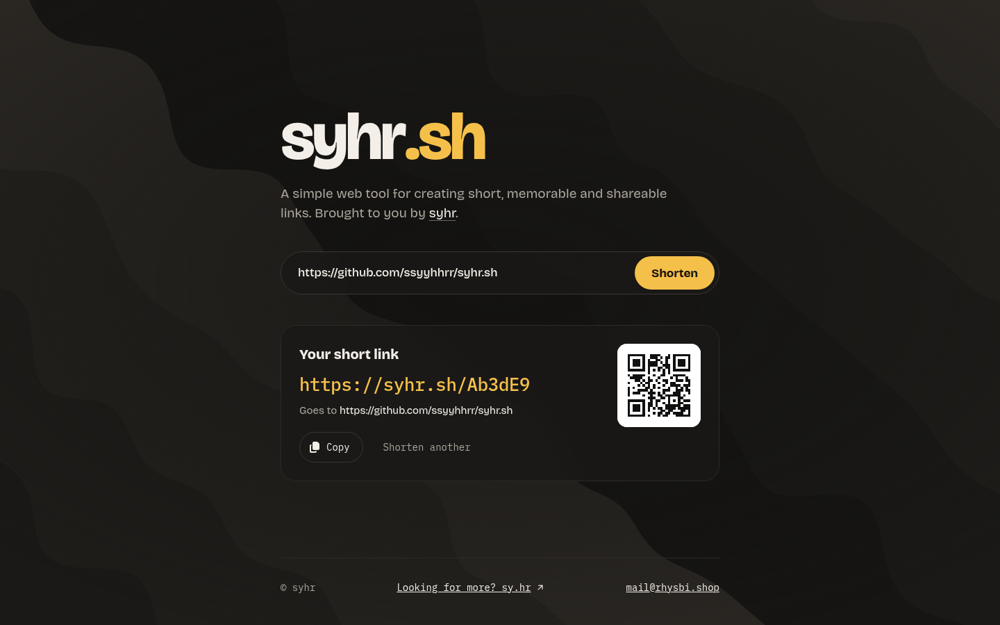
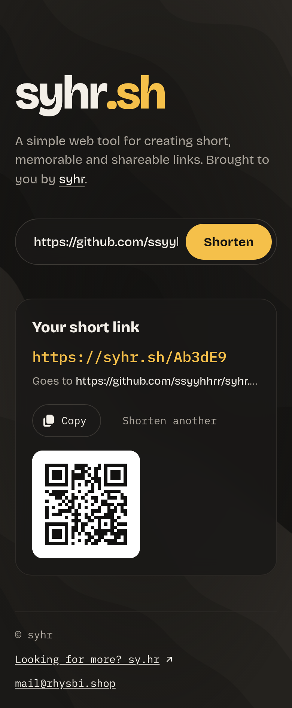

<a name="readme-top"></a>
[![Contributors][contributors-shield]][contributors-url]
[![Forks][forks-shield]][forks-url]
[![Stargazers][stars-shield]][stars-url]
[![Issues][issues-shield]][issues-url]
[![Docker Pulls][docker-shield]][docker-url]
[![MIT License][license-shield]][license-url]

<!-- PROJECT LOGO -->
<div align="center">
  <h3 align="center">syhr.sh</h3>
  <p align="center">
    A simple web tool for creating short, memorable and shareable links written with Node.js.
    <br />
    🌐 <a href="https://syhr.sh/">View Demo</a>
    ·
    🐛 <a href="https://github.com/ssyyhhrr/syhr.sh/issues">Report Bug</a>
    ·
    ✨ <a href="https://github.com/ssyyhhrr/syhr.sh/issues">Request Feature</a>
  </p>
</div>

---

<!-- TABLE OF CONTENTS -->
<details>
  <summary>Table of Contents</summary>
  <ol>
    <li><a href="#-about-the-project">About The Project</a></li>
    <li><a href="#-usage">Usage</a></li>
    <li><a href="#-self-hosting">Self-hosting</a></li>
    <li><a href="#-contributing">Contributing</a></li>
    <li><a href="#-license">License</a></li>
    <li><a href="#-contact">Contact</a></li>
  </ol>
</details>

---

<!-- ABOUT THE PROJECT -->

## 🔗 About The Project

<p float="left">
  
  
</p>

syhr.sh is a lightweight URL shortener for creating short, memorable, and shareable links. Paste a
long link, press **Shorten**, and get a short one with a QR code, ready to copy or share. No
sign-up, no tracking, and it works without JavaScript.

---

<!-- USAGE -->

## 🚀 Usage

Visit [https://syhr.sh/](https://syhr.sh/) to start shortening links instantly — no setup required.

---

<!-- SELF-HOSTING -->

## 🐳 Self-hosting

syhr.sh runs as a single Docker container with its database on a volume. Put it behind a reverse
proxy (Caddy, nginx, Traefik) that handles TLS, using [`compose.yaml`](compose.yaml):

```sh
docker compose up -d
```

Settings are environment variables:

| Variable                | Default           | Meaning                                                    |
| ----------------------- | ----------------- | ---------------------------------------------------------- |
| `PUBLIC_URL`            | `https://syhr.sh` | Where the site lives; short links are built on it          |
| `TRUST_PROXY`           | unset             | `1` to read visitors' IPs from the proxy (behind one only) |
| `RATE_LIMIT_PER_MINUTE` | `10`              | Links one visitor may create per minute                    |
| `RATE_LIMIT_PER_DAY`    | `100`             | Links one visitor may create per day                       |
| `PORT`                  | `4000`            | Port to listen on                                          |

Manage links with the `syhr` command inside the container:

```sh
docker exec syhrsh syhr links add https://google.com --slug kachow
docker exec syhrsh syhr links list
docker exec syhrsh syhr links delete kachow
docker exec syhrsh syhr domains block evil.example
docker exec syhrsh syhr help
```

---

<!-- CONTRIBUTING -->

## 🤝 Contributing

If you have a suggestion that would make this better, please fork the repo and create a pull
request. You can also simply open an issue with the tag "enhancement".

To run it locally you need Node.js 24 or newer:

```sh
npm ci
npm run build
npm start      # http://localhost:4000
npm test       # type checks, lint, and the unit, API and browser tests
```

Don't forget to give the project a star! Thanks again!

1. Fork the Project
2. Create your Feature Branch (`git checkout -b feature/AmazingFeature`)
3. Commit your Changes (`git commit -m 'Add some AmazingFeature'`)
4. Push to the Branch (`git push origin feature/AmazingFeature`)
5. Open a Pull Request

---

<!-- LICENSE -->

## 📄 License

Distributed under the MIT License. See `LICENSE.txt` for more information. Icons are from Font
Awesome Free (CC BY 4.0); Bricolage Grotesque and IBM Plex Mono are under the SIL Open Font
License.

---

<!-- CONTACT -->

## 📬 Contact

Rhys Bishop - [https://sy.hr/](https://sy.hr/) - mail@rhysbi.shop

Project Link: [https://github.com/ssyyhhrr/syhr.sh](https://github.com/ssyyhhrr/syhr.sh)

<!-- MARKDOWN LINKS & IMAGES -->
<!-- https://www.markdownguide.org/basic-syntax/#reference-style-links -->

[contributors-shield]: https://img.shields.io/github/contributors/ssyyhhrr/syhr.sh.svg?style=for-the-badge
[contributors-url]: https://github.com/ssyyhhrr/syhr.sh/graphs/contributors
[forks-shield]: https://img.shields.io/github/forks/ssyyhhrr/syhr.sh.svg?style=for-the-badge
[forks-url]: https://github.com/ssyyhhrr/syhr.sh/network/members
[stars-shield]: https://img.shields.io/github/stars/ssyyhhrr/syhr.sh.svg?style=for-the-badge
[stars-url]: https://github.com/ssyyhhrr/syhr.sh/stargazers
[issues-shield]: https://img.shields.io/github/issues/ssyyhhrr/syhr.sh.svg?style=for-the-badge
[issues-url]: https://github.com/ssyyhhrr/syhr.sh/issues
[license-shield]: https://img.shields.io/github/license/ssyyhhrr/syhr.sh.svg?style=for-the-badge
[license-url]: https://github.com/ssyyhhrr/syhr.sh/blob/main/LICENSE.txt
[docker-shield]: https://img.shields.io/docker/pulls/syhr/syhrsh.svg?style=for-the-badge
[docker-url]: https://hub.docker.com/r/syhr/syhrsh
